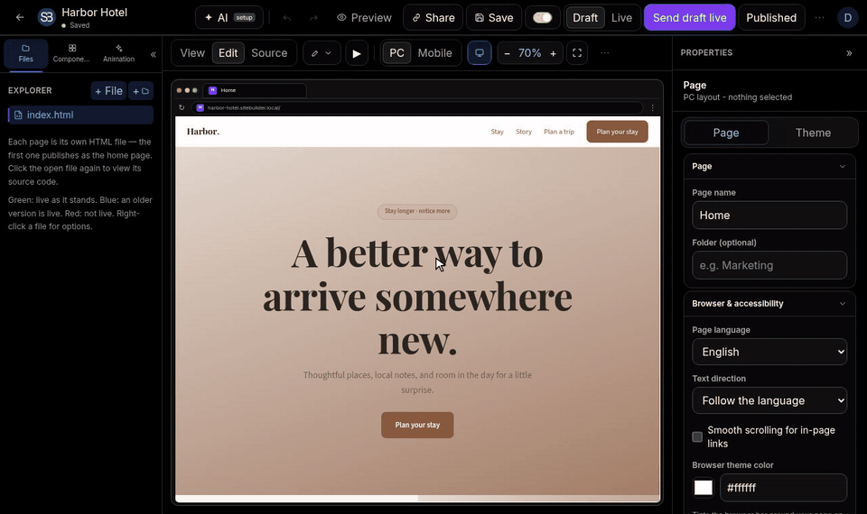
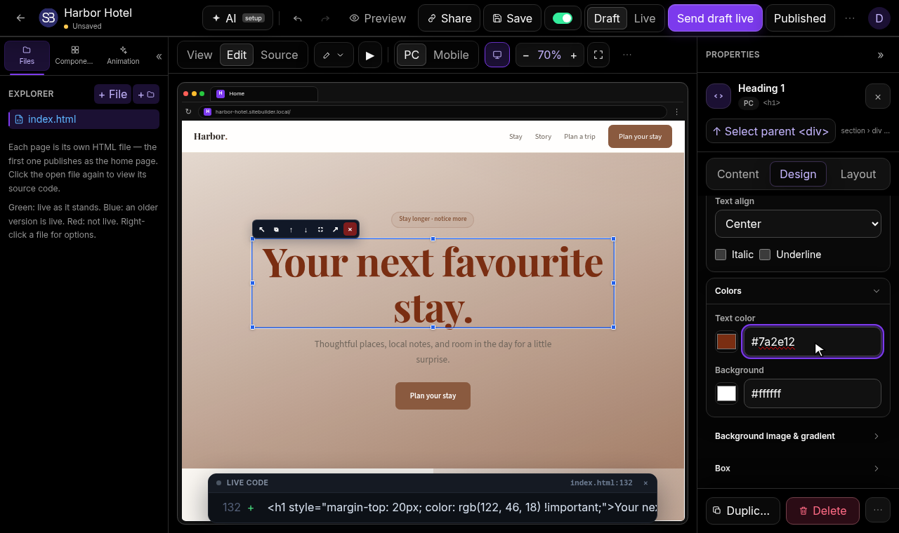
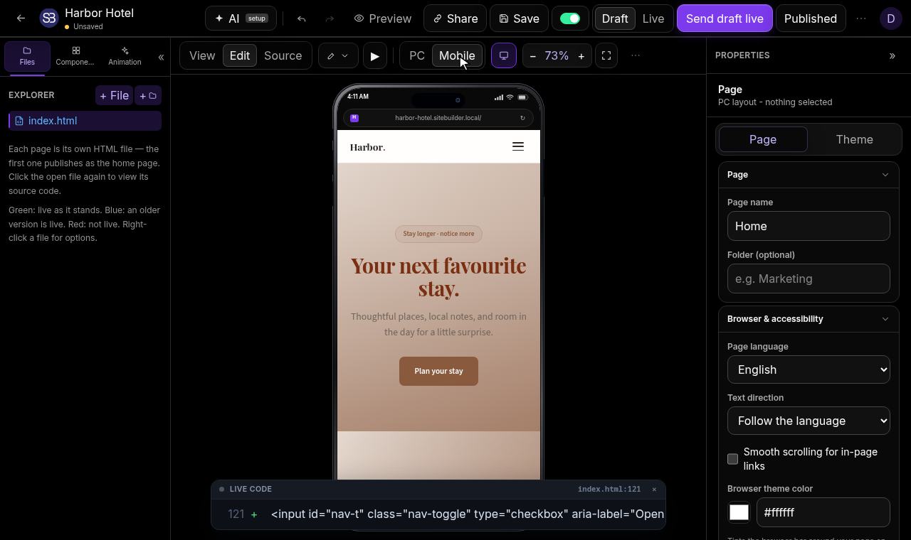
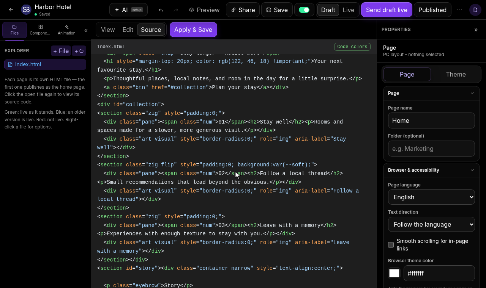

<p align="center">
  
</p>

<h1 align="center">SiteBuilder</h1>

<p align="center">
  <strong>An open-source website builder that outputs real, readable HTML.</strong><br>
  Edit a page by clicking on it, read the code it writes, publish it, and run it on your own server.
</p>

<p align="center">
  <a href="https://sitebuilt.app"><strong>Open the live site</strong></a> ·
  <a href="#installation--setup">Run it yourself</a> ·
  <a href="LICENSE">AGPL-3.0</a>
</p>

<p align="center">
  <a href="https://github.com/Ardakorkmaz0/SiteBuilder/actions/workflows/test.yml"></a>
</p>

<p align="center">
  
</p>

## What makes it different

Many visual builders keep your page inside them. Here the page is an HTML document you can read, edit by hand and take with you.

- **Readable output.** A page carries only the code it uses: a simple page is about 210 lines and 11 KB.
- **Your own HTML works.** Upload an existing page with its CSS, JavaScript and assets. It stays real HTML, and you can click on it and edit it.
- **Code and canvas together.** Every page has a source view with colored code, and you can see what each visual change wrote.
- **Nothing locks you in.** Export a site as an editable project or a single file, or host the whole builder yourself.

## Features

- A free canvas with ready-made blocks, or one of 500 templates
- Separate desktop and phone layouts
- Light and dark palettes visitors can switch, including following their device
- Drafts kept apart from the live site, with saved versions you can go back to
- Publishing to a public address, with a form inbox and visit counts

## Screenshots


<br>

<br>


## Status

Under active development. Every push runs about 3,100 frontend tests, 1,000 backend tests and an end-to-end suite in Chromium and Firefox.

One known limit: canvas pages are drawn at two fixed designs, and between them a page scales instead of reflowing. HTML pages use their own CSS and do not have this limit. Reworking this is the next big piece of work.

## Tech stack

- **Frontend:** React (Vite, JavaScript), Tailwind CSS, Zustand, @dnd-kit, React Router, axios
- **Backend:** Django + Django REST Framework, token auth, SQLite (JSON schema storage)

## Installation & Setup

Follow these steps to get the project running on your local machine. You need
**Git**, **Python 3.12+** and **Node.js 20+**. The backend and the frontend run
as two servers, each in its own terminal.

### Windows (PowerShell)
```powershell
# 1. Clone the repository from GitHub
git clone https://github.com/Ardakorkmaz0/SiteBuilder.git

# 2. Navigate into the backend directory
cd SiteBuilder\backend

# 3. Create a virtual environment named '.venv'
python -m venv .venv

# 4. Activate the virtual environment
.\.venv\Scripts\Activate.ps1

# 5. Install all required Python packages
pip install -r requirements.txt

# 6. Apply migrations to create the database tables
python manage.py migrate

# 7. Create an administrative user (for the Admin panel and the Settings page)
python manage.py createsuperuser

# 8. Start the Django API server on port 8001
python manage.py runserver 127.0.0.1:8001

# 9. In a second terminal, navigate into the frontend directory
cd SiteBuilder\frontend

# 10. Install all required Node packages
npm install

# 11. Start the Vite development server
npm run dev
```

### macOS / Linux (Bash)

If `node --version` fails, install Node.js first:

```bash
sudo pacman -S nodejs npm          # Arch / CachyOS / Manjaro
sudo apt install nodejs npm        # Debian / Ubuntu (or nvm for a newer Node)
brew install node                  # macOS
```

```bash
# 1. Clone the repository from GitHub
git clone https://github.com/Ardakorkmaz0/SiteBuilder.git

# 2. Navigate into the backend directory
cd SiteBuilder/backend

# 3. Create a virtual environment named '.venv'
python3 -m venv .venv

# 4. Activate the virtual environment (fish: source .venv/bin/activate.fish)
source .venv/bin/activate

# 5. Install all required Python packages
pip install -r requirements.txt

# 6. Apply migrations to create the database tables
python manage.py migrate

# 7. Create an administrative user (for the Admin panel and the Settings page)
python manage.py createsuperuser

# 8. Start the Django API server on port 8001
python manage.py runserver 127.0.0.1:8001

# 9. In a second terminal, navigate into the frontend directory
cd SiteBuilder/frontend

# 10. Install all required Node packages
npm install

# 11. Start the Vite development server
npm run dev
```

> **Copied the folder over from Windows?** A `backend/.venv` or
> `frontend/node_modules` installed on Windows does not work on Linux: the
> virtualenv has `Scripts\python.exe` instead of `bin/python`, and the packages in
> `node_modules` are Windows builds without the executable bit, so `npm run dev`
> fails with `vite: Permission denied`. Delete both and run the steps above again:
>
> ```bash
> rm -rf backend/.venv frontend/node_modules
> ```
>
> To keep the Windows virtualenv (a dual-boot drive, say), create the Linux one
> under another name instead, e.g. `python3 -m venv .venv-linux`; it is
> git-ignored.

Once started, visit **`http://localhost:5173/`** in your web browser. The API
runs on `http://127.0.0.1:8001/`.

> **Note:** The project defaults to **development mode** (DEBUG=True, SQLite, no
> `.env` needed). The backend uses port **8001**, not Django's usual 8000: 8000 is
> what every Django project defaults to, so on a machine running more than one the
> first to start takes the port and the others end up talking to the wrong API.
> For production, see [Going to production](#going-to-production).

### One command (Windows)

From the project root, double-click `start.bat` (or run it in a terminal). On the
first run it creates the virtual environment, installs the backend and frontend
packages, applies migrations, starts both servers and opens the browser.

```powershell
.\start.bat
```

If PowerShell blocks the script, run it explicitly:

```powershell
powershell -ExecutionPolicy Bypass -File .\start.ps1
```

### Tests

```bash
cd backend && pytest -q           # backend
cd frontend && npm run test:run   # frontend unit tests
cd frontend && npm run e2e        # end-to-end, in a real browser
```

The end-to-end suite (`frontend/e2e/`) starts the backend and Vite itself, or
uses them if they are already running, and signs up a fresh account for each
run. If `python` is not the backend's virtualenv, say which one:
`E2E_PYTHON=../backend/.venv/Scripts/python.exe npm run e2e` on Windows, or
`E2E_PYTHON=../backend/.venv/bin/python npm run e2e` on macOS/Linux. The first time,
install its browser with `npx playwright install chromium`. CI runs all three
on every push.

## Going to production

The app runs the same code in dev and prod — production hardening (Postgres,
HTTPS/HSTS, CSP and rate limiting)
turns on automatically when `DJANGO_DEBUG=False`. See **[DEPLOY.md](DEPLOY.md)**
for the launch checklist (secrets, hosts, TLS, Redis for shared throttling) and
the deferred items (email password-reset, S3 media, JWT) with how to wire each.

## Settings page (no env edits needed)

A **superuser** can configure Google sign-in, reCAPTCHA, email/SMTP and the
frontend URL from inside the app — **Admin → Settings** (`/admin/settings`) — with
no env edits or restart. Saved values take effect immediately. Each field is
**optional and falls back to the matching env var** when left blank, so the
env-based setup below still works and you can mix the two. Secrets (reCAPTCHA
secret, SMTP password) are write-only: the page shows whether each is configured
but never displays the stored value, and saving with the field blank keeps it.

> Infrastructure that must exist before the app boots — `DJANGO_SECRET_KEY`,
> `DATABASE_URL`, `DJANGO_ALLOWED_HOSTS`, `DJANGO_DEBUG` — stays in env by design
> (it can't live in the database the app connects to). Grant superuser with
> `python manage.py createsuperuser` (or `is_superuser=True`).

## Optional: Google sign-in, reCAPTCHA & Admin (env method)

Google sign-in and the "I'm not a robot" check are **env-gated**: with no keys the
app runs exactly as before (the Google button and the captcha simply don't show).
Add the keys below to turn each on, then restart both servers. (Or just use the
**Settings page** above — same effect, no restart.)

### Google sign-in

1. Go to the **Google Cloud Console → APIs & Services → Credentials**
   (<https://console.cloud.google.com/apis/credentials>).
2. *Create credentials → OAuth client ID → Application type: **Web application***.
   (First time, you'll be asked to configure the OAuth consent screen — pick
   "External", fill the app name + your email, and save.)
3. Under **Authorized JavaScript origins** add your frontend origin(s):
   `http://localhost:5173` (and your production URL when you deploy). You do **not**
   need a redirect URI — this uses the Google Identity Services token flow.
4. Copy the **Client ID** (looks like `1234-abc.apps.googleusercontent.com`) and put
   the **same value** in two places:
   - `backend/.env` → `GOOGLE_OAUTH_CLIENT_ID=...`
   - `frontend/.env` → `VITE_GOOGLE_CLIENT_ID=...`
5. Restart the backend and `npm run dev`. A "Continue with Google" button now
   appears on the Login/Register pages. (The backend verifies the Google ID token
   with the `google-auth` package — already in `requirements.txt`.)

### reCAPTCHA (the "I'm not a robot" box)

1. Open the **reCAPTCHA admin** (<https://www.google.com/recaptcha/admin>).
2. Register a site → choose **reCAPTCHA v2 → "I'm not a robot" Checkbox** → add the
   domain `localhost` (and your production domain).
3. Copy the two keys into:
   - `frontend/.env` → `VITE_RECAPTCHA_SITE_KEY=<site key>`
   - `backend/.env` → `RECAPTCHA_SECRET_KEY=<secret key>`
4. Restart. The checkbox now appears on Register and is verified server-side.

> The CSP already allows the Google/gstatic domains these scripts load from.
> See `backend/.env.example` and `frontend/.env.example` for the exact variable names.

### Admin panel (moderation)

The in-app **Admin** link (top-right, next to Favorites) and `/admin` page are
shown only to **staff** accounts. The panel has two tabs: **Users & sites**
(suspend/reinstate a user, unpublish or delete any site) and **Reports** (the
moderation queue from visitors' "⚑ Report" on public sites — resolve, dismiss,
or take the site down). Promote your account once:

```bash
cd backend
.venv\Scripts\python.exe manage.py shell -c "from django.contrib.auth.models import User; User.objects.filter(username='YOURNAME').update(is_staff=True)"
```

(or create a full superuser with `python manage.py createsuperuser`, which can also
use Django's own admin at `/admin/` on the backend.)

## License

Copyright (C) 2026 ArdaKorkmaz0

This program is free software: you can redistribute it and/or modify it under the terms of the
GNU Affero General Public License as published by the Free Software Foundation, version 3.

This program is distributed in the hope that it will be useful, but WITHOUT ANY WARRANTY; without
even the implied warranty of MERCHANTABILITY or FITNESS FOR A PARTICULAR PURPOSE. See [LICENSE](LICENSE)
for the full text.
