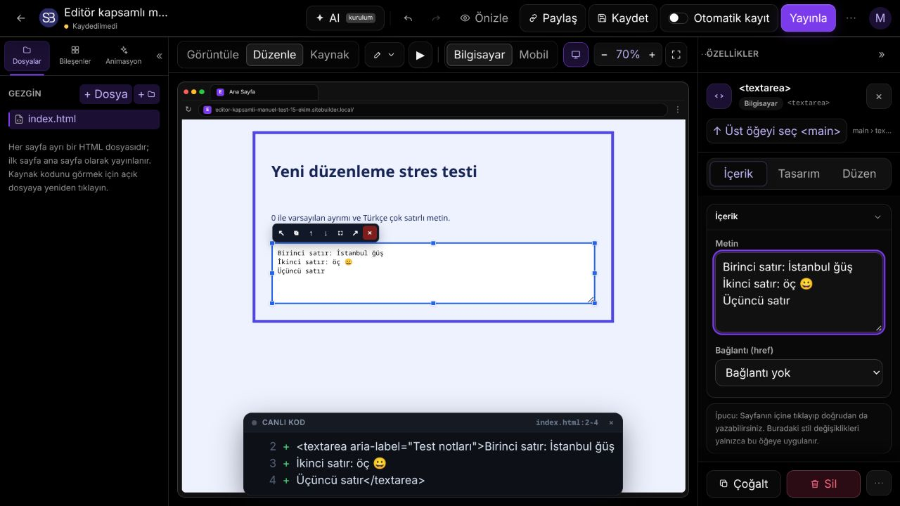
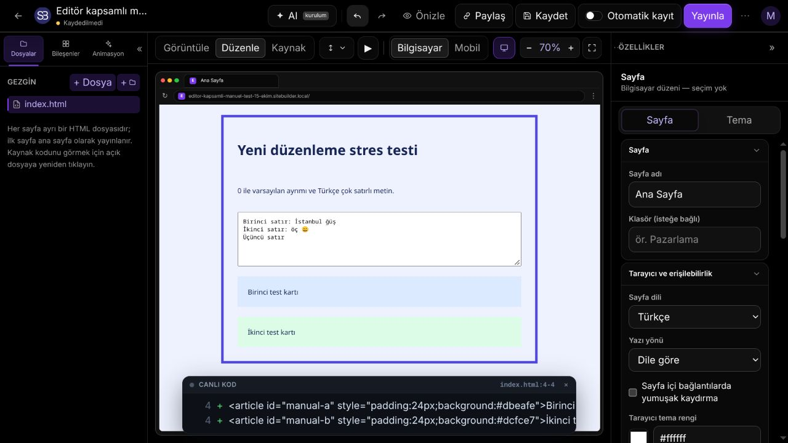

# İkinci editör düzenleme turu — 15 Ekim 2026

İlk kapsamlı turdan sonra kullanıcı daha fazla düzenleme testi istedi. Bu tur,
başarılı tek işlemlerden çok art arda yapılan işlemlere ve kayıt sınırlarında
taslağın korunmasına odaklanır. Önceki rapor: `EDITOR-TEST-2026-10-15.md`.

## Yeni doğrulanan hatalar

- Karma nested/üst düzey seçimde Cut, panoya alınmayan alt öğeyi de siliyordu.
  Kesme artık yalnız gerçekten panoya kopyalanan kök öğeleri kaldırır.
- Parent ve child birlikte seçildiğinde Duplicate, child'ı ikinci kez
  çoğaltıyordu. Seçili üst öğenin altındaki seçimler ayrıca klonlanmaz.
- Hızlı HTML modu değişimleri, kayıt araya girse bile bir geçmiş adımında
  birleşiyordu. Mod değişimleri artık ayrı geçmiş adımlarıdır.
- Kaynak panelinin tek dosya/optimize indirmeleri ve önizlemeleri uygulanmamış
  HTML taslağını atlıyordu. İndirmeler güncel taslağı içerir; kullanıcının kendi
  HTML dosyalarının bağlantıları korunur. Bilerek boşaltılmış taslak da korunur.
- Kaynak kopyalama düğmesi clipboard işlemi tamamlanmadan başarı gösteriyor,
  izin reddini yakalamıyordu. Başarı beklenir; hata gösterilir ve tekrar denenir.
- Bileşen sayfasında özel CSS/JS normal View'da çalışmıyordu. Bu sayfaların
  önizlemesi de yayınlama ile aynı korumalı HTML çerçevesinde çalışır.
- Kaydedilmemiş Source metni araç çubuğu Undo/Redo sırasında atlanabiliyordu.
  İlk taslak da geri alınabilir; Redo tam metni korur. Yeni düzenleme dalı eski
  Redo adımlarını geçersiz kılar.
- Sayfa ekleme/silme/yeniden adlandırma ve farklı editör moduna geçiş sırasında
  açık kaynak taslağı kaybolabiliyordu. Geçiş öncesi iki kaynak çalışma alanı da
  taslaklarını aktarır.
- HTML taslağının geçmiş zamanı React updater içinde geç hesaplanıyordu. Bir
  sonraki sayfa silme işleminden daha yeni görünüp yanlış Undo adımı seçiliyordu.
  Zaman, kullanıcı işlemi sırasında senkron olarak ayrılır.
- Açık olmayan boş bileşen sayfasına HTML dosyası aktarıldığında geçmişin eski
  belgeyi okuması ertelenebiliyor, Undo yeni belgeyi tekrar yükleyebiliyordu.
  Önceki HTML de updater çalışmadan önce yakalanır. Boş ve mevcut HTML hedefleri
  için ayrı dosya aktarımı/Undo/Redo/kayıt/yeniden açma senaryoları eklendi.
- Silinen sayfa Undo ile geri getirildikten sonra, sayfa açık değilken yeni HTML
  aktarmak eski silme işleminin Redo kaydını bırakıyordu. Yeni belge düzenlemesi
  artık her iki geçmişteki eski Redo dalını da kapatır; düğme ve klavye kısayolu
  ile yeni içeriğin tekrar silinmesi engellenir.
- “Kaydetmeden çık” sonrasında kuyruktaki otomatik kayıt, vazgeçilen başlığı
  sunucuya yazabiliyordu. Otomatik görev çalışmaya başlarken çıkış tercihini
  yeniden kontrol eder.
- HTML'yi kaldırma, belge ve sayfa modu olarak iki ayrı geri alma adımıydı.
  Tek store geçmiş adımı her ikisinin de önceki halini geri getirir.
- HTML geri getirildikten sonra yeni kaynak metni yazıp sayfa adını değiştirmek,
  ad değişikliğini geri alırken eski HTML'yi geri yükleyebiliyordu. Şema ile HTML
  eşleşmesi güncel taslağı senkron olarak izler; aynı oturumdaki ardışık
  düzenleme, kayıt ve Undo işlemleri son belgeyi korur.
- HTML sayısal alanlarında 0 ve boş/default birbirine karışıyordu. Padding,
  kenarlık, gap, boyut/auto, maksimum genişlik ve z-index değerleri hem PC hem
  mobilde ayrı işlenir. Boş değer desteği yalnız HTML sayı alanlarında açılır.
- Textarea içerik paneli satır sonlarını `<br>` olarak yazıyor ve canlı value'yu
  güncellemiyordu. Unicode çok satırlı metin hem varsayılan hem canlı değere
  doğru yazılır.
- Eski iframe belgesinden geciken input heartbeat/seçim olayları yeni belgeyi
  kirli gösterebiliyor veya eski seçimi açabiliyordu. Olayların belge sahipliği
  doğrulanır.

## Yeni tarayıcı senaryoları

| Dosya | Sayı | Kapsam |
| --- | ---: | --- |
| `editor-canvas-stress.spec.js` | 6 | Karma Cut, ancestor/child Duplicate, sayfalar arası clipboard/anchor/mobil sınırlar, nested pointer sınırları, gizli alt öğe kurtarma, PC/mobil history |
| `editor-code-stress.spec.js` | 4 | Uygulanmamış kaynağın indirilmesi, CSS/JS View+reload, metin alanında native Undo/Ctrl+S, HTML kaldırma/Undo ve sonraki belge düzenlemeleri |
| `editor-html-stress.spec.js` | 8 | Zero/default, auto/no-max/z-index, mobil sıfır/reset, textarea Unicode satırları, Source/Edit/View geçmişi, nested link hedefleri, drag olayları, seri seçim/yazma |
| `editor-save-stress.spec.js` | 11 | İnaktif HTML/bileşen sayfasına dosya aktarımı ve Undo/Redo, bekletilmiş kayıt, kayıt sırasında yeni metin/başlık/sayfa geçişi, kuyrukta Ctrl+S, dirty/unload, kaynak Undo/Redo, sayfa ekleme/silme kurtarma, 500 sonrası leave tekrarı, discard/publish/unpublish kuyrukları |

Manuel olarak Türkçe arayüzde ilk Source taslağı Undo/Redo, üç satırlı Türkçe ve
emoji metninin textarea içerik panelinden düzenlenmesi ve nested iki article'ın
gerçek pointer ile sıralanması/Undo denenmiştir. Otomatik HTML drag senaryosu,
Chromium/CDP'nin native drag başlangıcındaki takılmasını ayırmak için gerçek
DragEvent/DataTransfer ile uygulamanın drag handler zincirini çalıştırır; bu
manuel gerçek pointer denemesinden ayrı bir kontroldür.

## Kod incelemesi için başlangıç noktaları

| Kaynak | İncelenecek alan |
| --- | --- |
| `frontend/src/pages/EditorPage.jsx` | `setPageHtmlMap`, `commitHtml`, `undoOnHtmlPage`, `flushWorkspaceDrafts`, `importHtmlIntoPage`, otomatik kayıt kuyruğu ve `componentViewNeedsIframe` |
| `frontend/src/store/editorStore.js` | Kesme/çoğaltmada seçili ağaç kökleri ve `setPageMode` geçmişi |
| `frontend/src/components/editor/CodePanel.jsx` | `pendingExportHtml` ve asenkron `copy` |
| `frontend/src/components/editor/PageFilesPanel.jsx` | Ekle/sil/adlandır öncesi taslağın aktarılması |
| `frontend/src/utils/htmlElementEdit.js` | PC/mobil sayısal stil atama ve temizleme ayrımı |
| `frontend/src/components/editor/controls.jsx` ve `HtmlElementPanel.jsx` | HTML sayı alanlarında `allowEmpty` |
| `frontend/src/utils/domMultilineText.js` | `writeElementMultilineText` textarea dalı |
| `frontend/src/components/editor/HtmlWorkspace.jsx` | Eski belgeye ait gecikmiş input/seçim olaylarının reddedilmesi |

## Test ortamı ve sınırlar

- Chromium/Linux, yerel Django ve üretim derlemesinin yerel Vite önizlemesi.
  Tek worker kullanılır; testler yerel test hesaplarına ve test sitelerine aittir.
- Önizleme derlemesinde API açıkça yerel sunucuya sabitlenir:

```bash
VITE_API_URL=http://127.0.0.1:8001/api NODE_OPTIONS=--no-experimental-webstorage npm run build
NODE_OPTIONS=--no-experimental-webstorage npm run preview -- --host 127.0.0.1 --port 5173 --strictPort
E2E_PYTHON=../backend/.venv-linux/bin/python E2E_CHROMIUM_EXECUTABLE=/usr/bin/chromium NODE_OPTIONS=--no-experimental-webstorage npm run e2e
NODE_OPTIONS=--no-experimental-webstorage npm run test:run -- --maxWorkers=4
NODE_OPTIONS=--no-experimental-webstorage npm run lint
```

- İlk statik önizleme yanlışlıkla `.env.production` API adresini almıştı. Koşu
  durduruldu; trace'teki üretim API girişimleri CORS/preflight hatasıyla başarısız
  oldu, başarılı üretim yazımı görülmedi. Yerel adres derlenmiş bundle içinde
  doğrulandı ve tüm geçerli koşular yerel API ile tekrarlandı.
- Gerçek AI sağlayıcısı, DNS/SMTP ve işletim sistemi dosya seçicisi denenmedi.
  Bunlar önceki raporda belirtilen kapsam sınırları olarak sürer.
- Manuel otomasyon kaydında URL/stack içermeyen bir MutationObserver hata
  satırı görüldü. Üç ürün runtime gözlemci yolunda aynı hata zorla oluşturularak
  yakalandığı doğrulandı; kayıt bu kaynaklara atfedilemedi. Kanıtsız bir ürün
  değişikliği yapılmadı. E2E testleri yakalanmayan sayfa hatalarını da takip eder.

## Manuel ekran kanıtı




