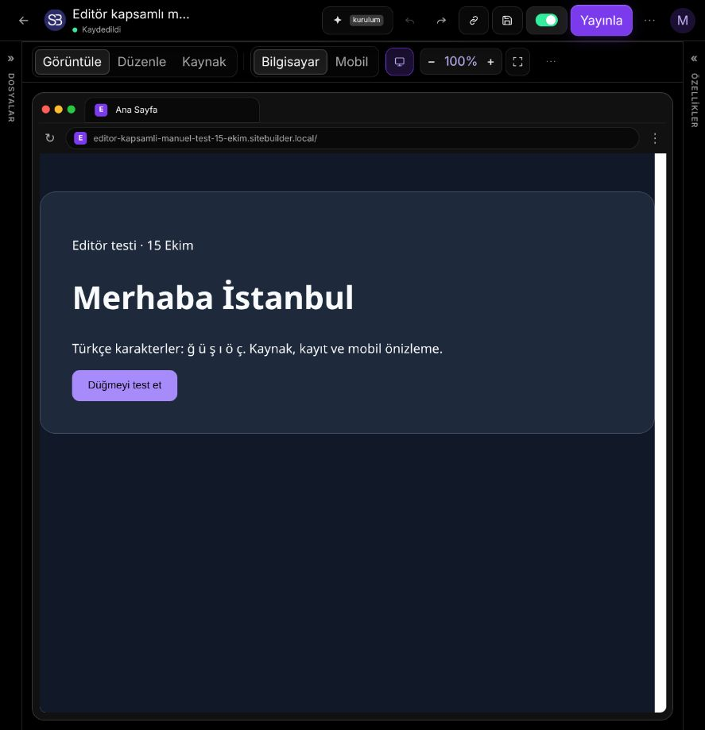
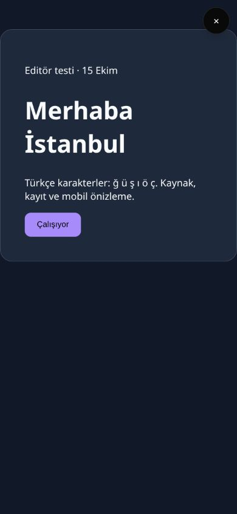

# Editör test turu — 15 Ekim 2026

Kullanıcının “editörde her şeyi kendin test et” isteği üzerine bileşen tuvali,
HTML çalışma alanı ve editörün yan araçları gerçek Chromium üzerinden sınandı.
Önceki test turunun değişiklikleri korundu. Bu rapor yalnız bu turdaki yeni
incelemeyi anlatır; önceki kapsam `TEST-FOLLOWUP-2026-10-15.md` dosyasındadır.

## Doğrulanan hatalar ve düzeltmeler

1. Telefona özel tasarımda Duplicate yalnız bilgisayar yerleşimini kaydırıyordu.
   Kopya telefonda orijinalinin üstüne düşüyordu. Her iki yerleşim artık kaydırılır.
2. Sağ kenarda Duplicate/Paste tuval dışına çıkıp yeniden yüklemede başka konuma
   sıçrayabiliyordu. Kopyalar iki ekranın da genişliğine göre sınırlandırılır.
3. HTML gezinme menüsüne ardışık eklenen bağlantılar ters sırada oluşabiliyor,
   klonlar aynı kimlikleri ve etkin sayfa işaretini taşıyabiliyordu. Sıra korunur,
   klon kimlikleri yenilenir ve etkinlik işaretleri temizlenir.
4. HTML özellik panelindeki bazı seçimler şablonun `!important` kurallarını
   geçemiyordu. Açıkça seçilen tipografi, renk ve düzen değerleri artık uygulanır.
5. Mobil özellik paneli bazı efekt/katman alanlarında bilgisayar değerini
   gösteriyordu. Telefonun aktif değerleri okunur.
6. Gölge/kenarlık için None, opaklık için 1, taşma için Visible ve italik için
   kapalı seçimi şablon stilini geri getiriyordu. Bunlar artık açık kapatma
   değerleri yazar; boş Default seçeneği CSS kuralına geri dönmeye devam eder.
7. Kontrol merkezinde aktif Inbox/Analytics/Share sekmesine yeniden tıklamak
   yükleniyor durumunu kalıcı bırakıyordu. Aktif sekme yeniden başlatılmaz.
8. Inbox okundu/silme, yorum çözme ve review bağlantısı yenileme hataları
   yakalanmıyordu. Panel hatayı gösterir, tekrar denemeye izin verir ve çakışan
   işlemleri engeller.
9. Kontrol merkezi, henüz uygulanmamış Source taslağı yerine eski HTML'yi
   okuyordu. Açılışta canlı taslak aktarılır; içerik düzenlemesi diğer kaynak
   değişikliklerini korur. Kaynak ve içerik düzenlemeleri ayrı ayrı Undo yapılır.
10. Dar ekranda Kaydet ve AI düğmelerinin adı kayboluyor; keşif kategorisi ve
    etiket alanları etiketsiz kalıyordu. Erişilebilir adlar eklendi.
11. Iframe belgesi yenilendiğinde eski belgedeki seçili öğe hâlâ `isConnected`
    görünebiliyordu. Bu öğeye yapılan değişiklikler ekrana yansımıyordu. Seçim,
    boyutlandırma ve üst öğe işlemleri artık aktif belgenin sahipliğini kontrol
    eder; yükleme sırasında eski seçim ve bağlantı kaynağı temizlenir.

## Gerçek tarayıcı kapsamı

| Alan | Sınanan davranışlar |
| --- | --- |
| Bileşen tuvali | İçerik/stil/konum/boyut, zoom altında pointer sürükleme ve resize, hizalama/dağıtma, çoklu seçim, grup taşıma, ardışık kopyala/yapıştır, kes, Duplicate, Undo/Redo, nested katman/üst öğe/silme, bilgisayar–mobil bağımsızlığı ve görünürlük, kenar sınırları, sayfa ayarları ve sayfaya kopyalama |
| HTML | Source/Save/reload, metin ve tipografi, şablon CSS önceliği, mobil stil ve sıfırlama, efektleri kapatma, çerçeve/zoom/yenileme, link araçları, gezinti CRUD, fırça, animasyon, spotlight, sıralama/çoğaltma/silme/Undo/Redo, pointer resize, bileşen yerleştirme/iptal, View etkileşimi |
| Dosyalar ve kayıt | İki sayfa modu, klasörler, Türkçe adlar, sayfaya HTML import, silme/iptal/Undo, karışık HTML+bileşen JSON export/import/Undo, checkpoint oluştur/pin/overwrite/restore, kurtarma, notlar ve takvim, reload kalıcılığı |
| Kontrol merkezi | SEO, içerik ve görsel açıklaması, pending Source aktarımı, Undo, Inbox okundu/okunmadı/sil, Analytics, yorum çöz/aç, review bağlantısı, hata mesajı/tekrar deneme/çift işlem koruması |
| Editör kabuğu | 887px araç çubuğu ve kaydetme, AI anahtarsız kurulum/disabled gönderim, açık/koyu tema, Türkçe/İngilizce, kategori/etiket kalıcılığı, kısayol penceresi/Escape/odak dönüşü, 390px telefon önizlemesi/sayfa seçimi/odak/masaüstüne dönüş |

Manuel olarak ayrıca Türkçe misafir oturumunda yeni site kurulumu, HTML'ye
geçiş, kayıt ve reload, gerçek JavaScript düğme etkileşimi, paylaşım/yayın için
hesap gereksinimi ve iptal akışları denendi. HTML başlığı paragrafın altına
gerçek pointer hareketiyle sürüklendi; Undo/Redo ile sırası doğrulandı. Tam ekran
önizleme ve Escape ile dönüş de kontrol edildi. Koyu/açık görünüm görsel olarak
incelendi. Telefon için geçici viewport ayarı test sonunda kaldırıldı.

## Doğrulama sonuçları

- Bu tur **26 yeni birim testi** ve **32 yeni Chromium kullanıcı senaryosu**
  eklendi: tuval 6, HTML 14, iş akışları 8, editör kabuğu 4.
- Frontend: **225 dosyada 2.163/2.163 test geçti** (`--maxWorkers=4`).
- ESLint ve üretim derlemesi başarılı; `git diff --check` temiz.
- Nihai seri Chromium paketi **65/65 geçti (5,3 dakika)**: 64 kullanıcı
  senaryosu ve 1 oturum hazırlığı. Eski senaryolar ve 32 yeni senaryo birlikte
  çalıştırıldı. Koşu sırasında kaynak ve test dosyaları değiştirilmedi.

Yeni test dosyaları:

- `frontend/e2e/editor-canvas-sweep.spec.js`
- `frontend/e2e/editor-html-sweep.spec.js`
- `frontend/e2e/editor-workflow-sweep.spec.js`
- `frontend/e2e/editor-shell-sweep.spec.js`
- `frontend/src/store/editorStore.canvasSweep.test.js`
- `frontend/src/utils/htmlElementEdit.off.test.js`
- `frontend/src/components/editor/SiteControlCenter.workflow.test.jsx`
- `frontend/src/components/editor/HtmlWorkspace.staleSelection.test.jsx`

Çalıştırma komutları (`frontend` dizininden):

```bash
NODE_OPTIONS=--no-experimental-webstorage npm run test:run -- --maxWorkers=4
NODE_OPTIONS=--no-experimental-webstorage npm run lint
NODE_OPTIONS=--no-experimental-webstorage npm run build
E2E_PYTHON=../backend/.venv-linux/bin/python E2E_CHROMIUM_EXECUTABLE=/usr/bin/chromium NODE_OPTIONS=--no-experimental-webstorage npm run e2e
```

## Test ortamı ve sınırlar

- Testler yerel Django + Vite üzerinde, ayrı test hesapları ve test siteleriyle
  yapıldı. Yayın testleri yerel veritabanı ve yerel sunucu içinde çalışır.
- Gerçek ücretli AI üretimi, harici DNS doğrulaması ve SMTP teslimatı yapılmadı.
  Anahtarsız AI davranışı ve ağ hatası yolları sınandı.
- Tarayıcı doğrulaması Linux/Chromium üzerinde yapıldı; Safari/Firefox bu turda
  çalıştırılmadı.
- Gerçek işletim sistemi dosya seçicisi ve disk izni bu turda denenmedi.
  Önceki turda dosya sistemi hata durumları kontrollü handle'larla sınanmıştı.
- İlk paralel bağımsız E2E koşuları yerel SQLite yazma kilidine takıldı. Vite test
  dosyası değişimini de reload yaptığı için nihai doğrulama tek worker ile,
  kaynak ve test dosyaları değiştirilmeden yapıldı; tüm senaryolar geçti.
- Üretim derlemesinde mevcut büyük `HtmlElementPanel` parça uyarısı bulunur.
  Bu tur performans paketlemesi değiştirilmedi.

## Manuel ekran kanıtları




