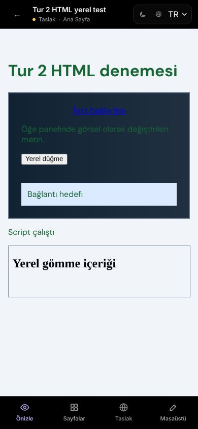

# Tur 2 — HTML sayfaları (ChatGPT, 19 Ekim 2026)

Başlangıç: `235000d`. Önce Tur 1 raporu ve Claude'un
`docs/CLAUDE-REVIEW-2026-10-19.md` incelemesi okundu. Bu tur HTML düzenleme
akışlarına odaklandı; canlıya alma yapılmadı.

## Tur 1 çapraz incelemesi

Boş tuval sihirbazı, yeni sayfa diyalogu ve tuval sekmelerinin ilgili üç test
dosyasında 13 test geçti. Sihirbaz bayrağını, Tab odağı tuzağını ve
`aria-selected` davranışını ayrı ayrı bozmak ilgili testleri kırdı.
Tur 1'in bütün tarayıcı, geometri ve ekran okuyucu kontrolleri tekrarlanmadı.

Sonraki `235000d` Enter düzeltmesinin testi odağın döndüğünü kontrol ediyor,
ama yeni odaklanan sayfa düğmesinin yanlışlıkla tıklanmadığını kontrol etmiyordu.
Mevcut test `onActiveClick` çağrılmamalı beklentisiyle güçlendirildi.
Yalnız Enter `preventDefault()` kaldırılınca 1 test kırıldı, geri konunca 6/6 geçti.

**Bölüme sürükleyerek taşıma hakkındaki karar:** desteklenmeli. Var olan öğenin
bölüme bağlanması, görünür konumunu koruyan koordinat dönüşümü, bölümden çıkarma,
telefon düzeni ve tek adımlık geri alma birlikte ele alınmalı. Bu turda bu yeni
davranış eklenmedi; ayrı değişiklik olarak planlanmalı. Tur 1'deki diğer açık
bulgular kapanmış sayılmıyor; klavye duyuruları ve şablon önizlemesi odağı Tur 9'da.

## Bulunan ve düzeltilenler

| Sorun | Değişiklik | Kanıt |
| --- | --- | --- |
| Telefon düzeninde satır içi bağlantıya yatay hizalama uygulanmıyordu | Yalnız satır içi öğeye telefonda `display:block` ve `width:fit-content` veriliyor; PC stili korunuyor | Gerçek iframe'de merkez farkı yaklaşık 0,007 px; PC'ye dönünce `display:inline` |
| Önce tek kenar iç boşluğu, sonra genel iç boşluk verilince eski kenar üstün geliyordu | Genel değer eski telefon kenarlarını kaldırıyor; boşaltma ve sıfır değeri de doğru uygulanıyor | Üst 8 → genel 24: dört kenar 24 px; 0 ve boşaltma geçti; PC 40 px kaldı |
| Türkçe CV hazır şablonlarında tarih hâlâ `2022 — Present` idi | Yalnız bilinen örnek metin `2022 — Günümüz` olarak yerelleştirildi | Gerçek şablon seçimiyle doğrulandı; İngilizce, özel tarihler, kod ve bağlantı değerleri korunuyor |

Claude'un önceki incelemesindeki kaynak belge testi açığı da kapatıldı.
CodePanel'in üç uygulama/dışa aktarma yolu ile panel kapalıyken EditorPage'in
bekleyen kaynak uygulaması artık aynı `componentSourceHtml` yardımcısını kullanıyor.
Kullanıcının HTML belgesi aynen kalıyor; tuval kaynağı üretilen CSS/JS'yi içine alıyor.
Yeni gerçek EditorPage testi, devam eden kayıt + kuyruktaki geçmiş yüklemesi +
telefon görünümünde panelin kapanmasını birlikte sürüyor. İki sayfanın kayıt
yükünü, yedek sunucu anlık görüntüsünü, revision'ı ve API çağrı sayılarını denetliyor.
Kayıt kuyruğu ve oturum hook'ları değiştirilmedi.

## Gerçek tarayıcıda denenenler

Codex uygulama içi Chromium tarayıcısında 1280×800 ve 390×844 kullanıldı.
8001/5173 sunucuları yalnız bu test için başlatıldı. `127.0.0.1` kökeninde yeni
misafir, sihirbazdan bir HTML sitesi ve üç HTML sayfası oluşturuldu. Kullanıcının
`localhost:5173/editor/567` sekmesinde düzenleme yapılmadı.

- Kendi HTML'ini yapıştırarak oluşturma; Kaynak / Düzenle / Görüntüle geçişleri.
- Görsel öğe panelinde paragraf metni değiştirme; geri al / yinele.
- Telefon hizalaması, genel/kenar iç boşluğu, sıfır ve sıfırlama; PC değerlerinin korunması.
- Telefon arka planı, degradenin iki rengi ve 90 derece açısı. Hesaplanan renkler
  `#112233` → `#203040`; kaydet ve yeniden yükleme sonrası korundu.
- Sakin Orman temasını sayfalara uygulama; tek geri alma ile önceki metin rengi,
  yineleme ile yeni renk. Kullanıcıya ait özel arka plan korunuyor.
- Bölüme Belirerek gel animasyonu uygulama; önizlemede hareket işaretleri duruyor.
  Animasyon zamanlaması, hover ve reduced-motion bu turda ölçülmedi.
- Var olan `#target` bağlantısını Görüntüle'de açma; editörden ayrılmadan hedef mevcut.
- Yerel `srcdoc` gömmesi; Görüntüle ve gerçek telefon önizlemesinde kullanıcı
  JavaScript'i çalışıyor. Düzenle'de script çalışmıyor; iki sandbox ayrımı korunuyor.
  Mobil ilk yükleme anındaki geçici metin, görünür sonuç beklenerek yeniden kontrol edildi.
- Kaynak metnini Uygula ve Kaydet; yeniden yükleme sonrası metin, telefon stili ve
  hareket verisinin kaynakta korunması.
- Yeni HTML sayfasını şablonla başlatma, CV seçimi ve Türkçe tarih; asıl sayfaya
  dönüşte metin/hizalama/iç boşluk/degradenin korunması.
- Gerçek dar ekran ziyaretçi önizlemesi, sayfa menüsü ve iç gömme görünümü.

Firefox, gerçek dokunmatik donanım, işletim sistemi dosya seçicileri ve herkese açık
yayın bu turun kapsamı değildi. Bağlantı seçeneklerinin ve şablon kataloğunun tamamı
tek tek denenmedi. Sıfır hata garantisi verilmiyor.

## Testler ve bağımsız inceleme

24 yeni test: telefon düzeni 9, kaynak belge sözleşmesi 3 (2 yardımcı + 1 gerçek
Page), şablon yerelleştirme 12. Ayrıca mevcut yeniden adlandırma testi güçlendirildi.

Telefon düzeltmesi öncesi 8 yeni test kırıldı, 1 mevcut davranış koruması geçti.
CV sözlük girdisi olmadan 12 yeni test kırıldı. Kaynak belge testleri, önceki
doğru davranışı koruyan ek kapsamdır: eski Page'deki `ownDocument` dalını her zaman
inline yapınca yeni gerçek Page testi kırıldı; eski doğru kodla geçti.

Yazan ajandan ayrı Codex incelemesi, izole kopyalarda hizalama dönüşümünü, yalnız
inline koşulunu, kenar temizliğini, kenardan sıfırlamayı, kaynakta her zaman
inline/her zaman raw dönüşümünü, yanlış sayfayı, fazladan API isteğini, CV çevirisini,
İngilizce ve çalıştırılabilir kod korumalarını bozdu. İlgili testler kırıldı;
son kaynaklarla geçti. Somut ek bulgu kalmadı. Bu, Claude onayı değildir;
Claude Tur 3'e başlamadan bu turu ayrıca incelemeli.

Yerel kanıt günlükleri (geçici dosyalar):

- `/tmp/sitebuilder-round2-mobile-layout-final-red.log`
- `/tmp/sitebuilder-round2-source-page-ownDocument-red.log`
- `/tmp/sitebuilder-round2-review-rename-red.log`
- `/tmp/sitebuilder-round2-cv-localization-red.log`
- `/tmp/sitebuilder-round2-source-review-*.log`
- `/tmp/sitebuilder-round2-review-mutation-*.log`
- `/tmp/sitebuilder-round2-review-localization-*.log`

Son kontroller:

| Kontrol | Sonuç |
| --- | --- |
| Frontend lint | Geçti |
| Vitest, Node 26 webstorage kapalı | 273 dosya, **2514 test geçti**, 105,64 sn |
| Frontend build | Geçti; mevcut büyük chunk uyarısı var |
| Backend pytest | **817 geçti**, 145,86 sn; 602 mevcut uyarı |
| Model/migration | Değişmedi |
| `git diff --check` | Temiz |

CI `tests` sonucu push edilen HEAD için ayrıca izlenir; yerel testler E2E yerine
geçmez. Tur 3 öncesinde bu commit'in GitHub Actions sonucu kontrol edilmeli.

İki test sunucusu durduruldu; yalnız bu tur için oluşturulan
`/tmp/sitebuilder-round2-20261019.sqlite3` silinerek misafir/site verileri temizlendi.
Üretim verisine dokunulmadı. Tarayıcı viewport geçici ayarı sıfırlandı.
Geçici test sekmesi kapanışta tarayıcı denetimi zaman aşımına uğradı; sekmeler
teslim olarak işaretlenmedi. Gerçek kullanıcı sekmesi kapatılmadı.

